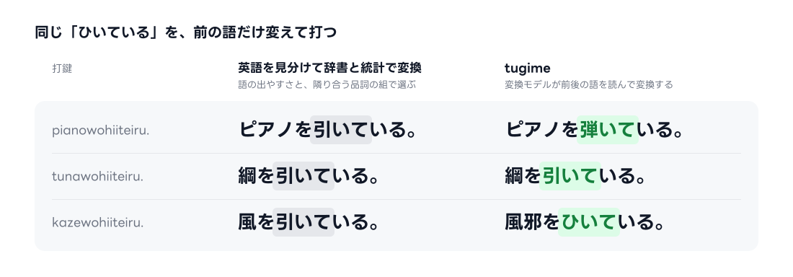
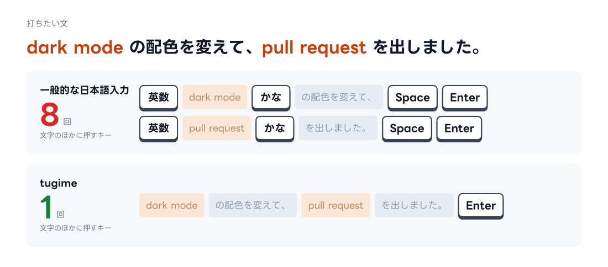
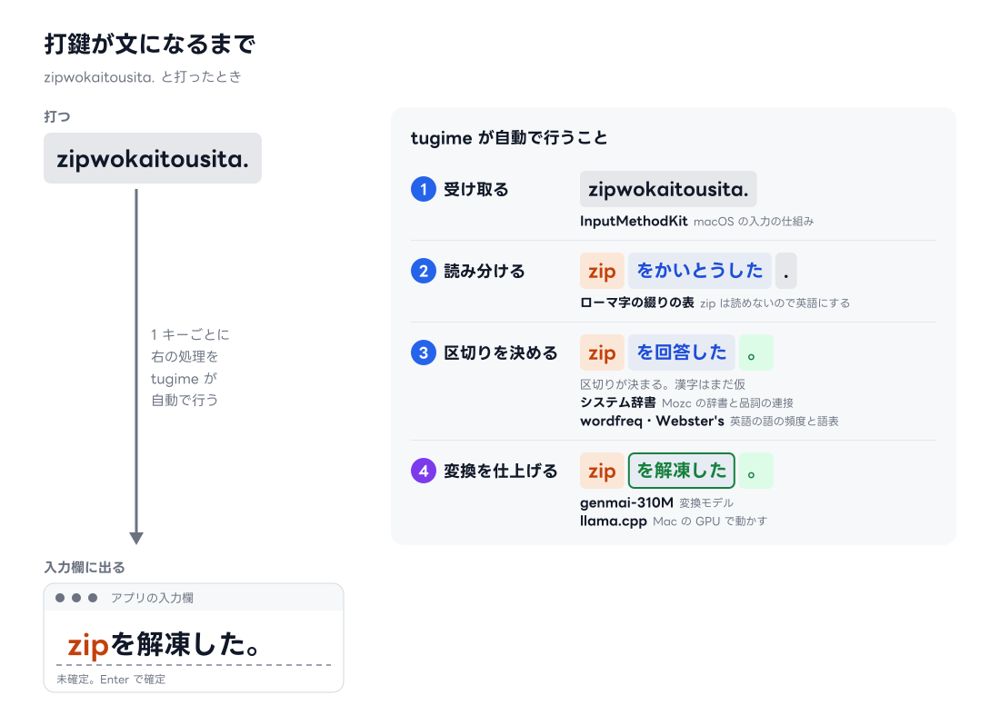
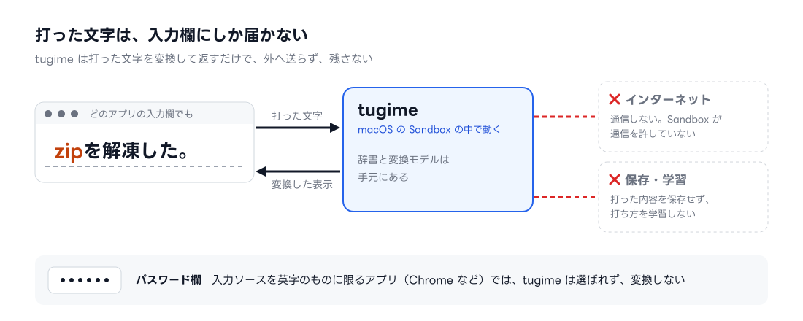

# tugime

打つそばから、文の流れに合わせて自動変換。英単語を混ぜても切り替えずに打てる macOS の日本語入力です。

/tsɯɡime/ 継ぎ目


英単語は英字のまま残り、日本語は文の流れに合わせて変換されます。

## 特徴

### 文の流れに合わせて自動変換



tugime は、ニューラルかな漢字変換の入力メソッドです。打つそばから、変換モデルが前後の語を読んで自動変換します。

### 英語まじりでも切り替えずに打てる



一般的な日本語入力で英語を混ぜるには、英語の前後で英数とかなを切り替えます。tugime は英単語を見分けて英字のまま残すので、日本語モードのまま打てます。

| 打鍵 | 日本語モードのライブ変換 | tugime |
|---|---|---|
| `ok` | おk | ok |
| `testgaotitanode` | てstが落ちたので | testが落ちたので |

Space はそのまま空白になるので、`pull request` のような空白入りの英語も英文と同じように打てます。英語として残したい語は、空白で区切って打つと英語に読まれやすくなります。`api` や `name` のようにローマ字としても読める語は、日本語になることがあります（[対処](docs/limitations.md#ローマ字としても読める英単語が日本語になる)）。

## 変換の仕組み



tugime は 1 キー打つたびに、打鍵列の全部をこの 4 つの工程に流し直します。ほかの日本語入力で崩れるのは、この工程の一部が無いためです。

- **日本語モードのライブ変換** には、工程 2 で読めない打鍵を英語にする分かれ道と、工程 3 で日本語と英語の区切り方を比べる処理がありません。日本語だけの文なら文脈に合った漢字を選べますが、英字もすべてローマ字として読むので、英単語が「おk」「てst」になります
- **英語を見分けて辞書と統計で変換する方式** は、工程 3 の仮の漢字で止まります。英単語は英字のまま残りますが、漢字は語の出やすさと隣り合う品詞の組の自然さで選ぶので、「zipを回答した」「動機が遅い」のような組になることがあります

上のデモと表の「日本語モードのライブ変換」は macOS 27 で実際に打った結果、「英語を見分けて辞書と統計で変換」は tugime の比較用の方式（`tugime-cli --method lattice`）の結果です。詳しい仕組みは [変換の仕組み](docs/how-it-works.md) にあります。

## 安全性



入力メソッドは、どのアプリで打った文字も受け取ります。tugime は、偽物を入れないためと、打った内容を外へ出さないために、次のことをしています。

- **導入**: 配布物が tugime のリポジトリで組み立てられたものかを確かめてから入れます。手順は「インストール」にあります
- **通信しない**: tugime は通信しません。さらに macOS の Sandbox で通信とファイルの読み書きを制限し、tugime に穴があって攻撃されたときの被害を減らします
- **記録しない**: 打ち方を学習せず、打った内容を保存しません
- **パスワード欄**: tugime を英字の入力ソースとして登録していません。パスワード欄で入力ソースを英字のものに限るアプリ（Chrome など）では、tugime が選ばれず、変換しません

## 動作環境

Apple Silicon の macOS です。動作は macOS 27 でだけ確かめています。

## インストール

改竄されていない tugime を安全に入れるために、配布物が tugime の release workflow で組み立てられたものかを確かめてから入れます。tugime は Apple の有料の公証を受けていないので、代わりに GitHub 上での署名と[出自の証明](https://docs.github.com/en/actions/how-tos/secure-your-work/use-artifact-attestations/use-artifact-attestations)を使います。

[Homebrew](https://brew.sh/) で [packslip](https://packslip.dev/) を入れます。

```bash
brew install packslip
```

packslip で tugime を入れます。packslip は確かめられた配布物だけを展開し、`tugime-install` がそれを配置して登録します。更新するときも、このコマンドを実行します。

```bash
packslip install github.com/miyaoka/tugime \
  --identity https://github.com/miyaoka/tugime/.github/workflows/release.yml@refs/heads/main
~/.local/bin/tugime-install
```

[Homebrew 以外のインストール方法（mise、GitHub CLI）](docs/install.md)

### 入力ソースを追加する

初めて入れたときだけ、一度ログアウトしてログインし直してください。システム設定は、ログインし直すまで新しい入力ソースを一覧に出しません。その後、システム設定 → キーボード → 入力ソース → 「+」→ 日本語 から `tugime` を追加します。tugime は自分では入力ソースを有効にしません。

## 使い方

ふだんどおりローマ字で打つだけです。

| キー | 動き |
|---|---|
| 英字・記号 | 打つそばから変換して表示します |
| Space | 空白を入れます。英語として残したい語は空白で区切って打ちます。続けてもう一度押すと、空白の前の語を英語にするか日本語にするかを候補から選べます（`make` → 負け → make） |
| Shift+Space / ↓ | 変換の候補を出します。打っている途中は最初の文節の候補です。候補が出ている間は次の候補へ進みます |
| 1〜9 | 候補が出ている間は、その番号の候補を選び、次の文節に移ります |
| ← / → | 選ぶ文節を左 / 右へ移します。空白だけの文節は飛ばします。打っている途中は、← で最後の文節、→ で最初の文節を選びます |
| Shift+← / Shift+→ | 選んでいる文節を縮める / 伸ばします |
| Enter | 表示しているとおりに確定します |
| Shift+Enter | 選んでいる文節と、その直後の空白までを確定し、残りは変換したまま次の文節を選びます。打っている途中は最初の文節とその直後の空白までを確定します。残りが無ければ全体を確定します |
| 英数 / かな | 英数モード（ABC などの英字の入力ソース）/ tugime に切り替えます |
| Ctrl+H / J / K / L | 未確定の文字列がある間は ← / ↓ / ↑ / → と同じです。ホームポジションのまま文節と候補を選べます |

英語だけの文は、英数モードで打ってください。英語のまま残したい語がかなになるときは、大文字で打つ（`API`）か、tugime の辞書に登録してください。すべてのキー操作と辞書の書き方は [使い方](docs/usage.md) にあります。

## ドキュメント

- [インストール方法](docs/install.md): mise と GitHub CLI でのインストール
- [使い方](docs/usage.md): キー操作、句読点と記号、日本語と英語の見分け方、tugime の辞書
- [変換の仕組み](docs/how-it-works.md): 区切りの決め方と、変換の仕方
- [現状の制限](docs/limitations.md): 誤った変換になる既知の例と対処
- [開発](docs/development.md): ソースからの組み立て、変換の確かめ方、精度の測り方、図の作り直し

## 使っているもの

tugime の変換は、次の辞書とモデルの上に作られています。

- システム辞書: [Mozc](https://github.com/google/mozc) の OSS 辞書・連接の表・文節の規則（BSD 3 条項。辞書は IPAdic と沖縄辞書の利用条件も伴う）
- [genmai-310M](https://huggingface.co/subdiox/genmai-310M)（CC BY-SA 4.0。[zenz-v2.5-medium](https://huggingface.co/Miwa-Keita/zenz-v2.5-medium) を元にしたモデル）と [llama.cpp](https://github.com/ggml-org/llama.cpp)（MIT）
- 既定のローマ字の綴り: [Mozc](https://github.com/google/mozc) の `src/data/preedit/romanji-hiragana.tsv`（BSD 3 条項。ライセンスの全文は `Sources/TugimeCore/Resources/romaji.tsv` の先頭）
- 英語の語の頻度: [wordfreq](https://github.com/rspeer/wordfreq) の日本語データ（CC BY-SA 4.0）
- 英語の綴りらしさを数える語表: macOS 同梱の Webster's Second International（1934 年、著作権切れ）と固有名詞表
- README と docs の図の字形: [LINE Seed JP](https://github.com/line/seed)（SIL Open Font License 1.1）

## ライセンス

tugime は [MIT](LICENSE) です。ただし `Sources/TugimeCore/Resources/` のデータは出典の利用条件に従います。条件はファイルの先頭か `App/Notices/` にあります。
