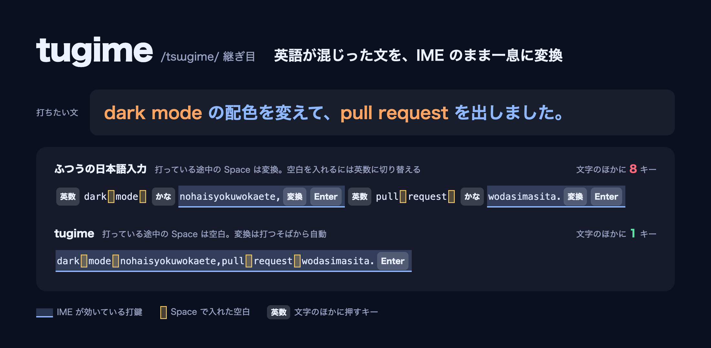
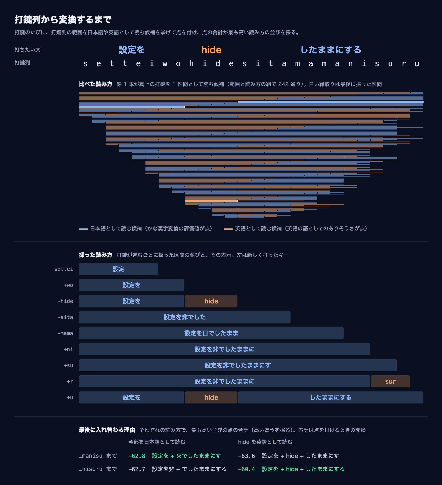

# tugime

/tsɯɡime/ 継ぎ目



macOS の日本語入力。英語が混じった日本語の文を、IME を切らずに一息に変換する。ローマ字の打鍵列から日本語の区間と英語の区間を見分け、日本語はかな漢字に変換し、英語は英字のまま残す。

```
github actionsdetestwohasirasetemergesuru.              →  github actionsでtestを走らせてmergeする。
dark mode nohaisyokuwokaete,pull request wodasimasita.  →  dark mode の配色を変えて、pull request を出しました。
nodewosakujosite,sitewokoukaisuru                       →  nodeを削除して、siteを公開する
```

英語だけの文は、英数に切り替えて打つ。

## 特色

### Space

打っている途中の Space は空白を入れる。ふつうの日本語入力では Space が変換に使われるので、英語の語句の間に空白を入れるには、確定して英数に切り替える必要がある。tugime は打つそばから変換して表示するので、変換の操作を挟まずに打ち進められる。キーの操作は「使い方」の表にある。

### 日英の判定



利用者のローマ字の綴りで読めない並び（`gl` `pr` `c` `l` など）を含む区間は英語になる。ローマ字として読める英単語（`node` `site` など）は、文の前後から日本語か英語かを決める。英語の後の句読点は、日本語の記号にせず打ったまま残る。

### 学習

打ち方を学習しない。同じ入力と同じ前後の文脈には、常に同じ結果を返す。

### かな漢字変換

[AzooKeyKanaKanjiConverter](https://github.com/azooKey/AzooKeyKanaKanjiConverter) を使い、表示する変換は Zenzai（小さな言語モデル）が前の文脈を見て選ぶ。

## 動作環境

Apple Silicon の macOS。動作は macOS 27 でだけ確かめている。

## 導入

[mise](https://mise.jdx.dev/) でインストールする。`postinstall` がインストール直後に GitHub Releases の版を `~/Library/Input Methods` に配置して登録する。更新は `mise up` で反映する。

```bash
mise use -g 'github:miyaoka/tugime[postinstall="\"$MISE_TOOL_INSTALL_PATH/install.sh\" \"$MISE_TOOL_INSTALL_PATH/tugime.app\""]'
```

mise を使わない場合は、最新版を取得して配置する。更新は同じコマンドで上書きする。

```bash
curl -fsSL https://raw.githubusercontent.com/miyaoka/tugime/main/install.sh | bash
```

Releases から `tugime-macos-arm64.tar.gz` を取得した場合は、展開したフォルダーで `bash install.sh` を実行する。

初めて配置したときだけ、ログアウトしてログインし直す。システム設定はログインし直すまで新しい入力ソースを一覧に出さない。その後、システム設定 → キーボード → 入力ソース → 「+」→ 日本語 から `tugime (日本語)` を追加する。tugime は自分では入力ソースを有効にしない。

配布物は ad-hoc 署名で、Apple の公証を受けていない。

### ソースから

Xcode（Swift 6.2 以降）が要る。組み立てのときに Zenzai のモデル（約 70MB）を Hugging Face から `.zenz/` に取得する。

```bash
scripts/build-app.sh                    # dist/tugime Local.app を組み立てて ad-hoc 署名する
./install.sh "dist/tugime Local.app"    # 配置して登録する
```

ソースから組み立てたものは `tugime Local` という別の入力ソースになり、配布版の tugime と並べて入れられる。入力ソースの追加では `tugime Local (日本語)` を選ぶ。

## リリース

main に `feat` か `fix` のコミットが入ると、CI が版（`vYYYY.M.PATCH`）を採番し、macOS で組み立てた `tugime-macos-arm64.tar.gz` を出自の証明付きでリリースする。

## 使い方

| キー | 動き |
|---|---|
| 英字・記号 | 未確定の文字列に足す。打っている途中も変換して表示する。かなが 4 文字以上の日本語の区間は漢字にし、それより短い区間はかなのまま、英語の区間は英字で表示する |
| Space | 打っている途中は空白を入れる。空白は英語の区間に入り、打ったまま残る。文節を選んでいる間は Shift+Space と同じ |
| Shift+Space | 文節に区切って最初の文節を選ぶ。もう一度押すと候補の窓を出し、その後は次の候補へ進む |
| ↓ / ↑ | 次の候補 / 前の候補 |
| ← / → | 選んでいる文節を縮める / 伸ばす。日本語は 1 かなずつ、英字は 1 文字ずつ。隣の英語・日本語も取り込め、読めない英字を含むと英字のまま残る。区間をまたいで日本語を取り込むときと、区間をまたいで伸ばした文節を縮めるときは、読み切れる綴りずつ（`tte` は `って`）。伸ばした後に縮めると、手放した英字は英字に戻る。日本語の記号にした句読点と記号は取り込まない |
| Shift+← / Shift+→ | 選ぶ文節を左 / 右へ移す |
| Enter | 表示しているとおりに確定する |
| Shift+Enter | 選んでいる文節までを確定し、残りは変換したまま次の文節を選ぶ |
| Esc / Backspace | 候補の窓を閉じる。窓が無ければ文節の選択をやめて、打っている途中の表示に戻る |
| F6 / F7 / F8 / F9 / F10 | 文節を選んでいる間は選んでいる文節を、打っている途中は未確定の文字列全体を、ひらがな / カタカナ / 半角カタカナ / 全角英数 / 打ったままにする |
| 英数 / かな | 英数モード / 日本語モードに切り替える |

- 打っている途中に矢印キーを押すと、Shift+Space を押さなくても最初の文節を選び、そのキーの動きをする
- `,` `.` `?` `!` `~` は、直前が日本語なら `、` `。` `？` `！` `〜` になり、直前が英語なら打ったまま残る
- `[` `]` `/` は常に `「` `」` `・` になる。`zh` `zj` `zk` `zl` は `←` `↓` `↑` `→`、`z.` `z/` `z-` `z[` `z]` は `…` `・` `〜` `『` `』` になる。英字のまま打つときは英数モードにする
- 綴りの表で最後まで読め、日本語の文の中に英字のまま書かれることの少ない綴り（`matte` など）と、読める 2 文字以下の綴り（`ie` など）は日本語になる。英字で残すときは F10 を押す
- パスワード欄などで安全入力が有効な間は、キーを変換せずにアプリへ渡す

## 綴りの表

既定の綴りは `Sources/TugimeCore/Resources/romaji.tsv` にある。書式はファイルの先頭に書いてある。差し替えたら組み立て直して配置する。

## 開発

```bash
swift build --product tugime-cli
zenz=$(scripts/fetch-zenz.sh)                                             # Zenzai のモデルを取得してパスを出す
.build/debug/tugime-cli --zenz "$zenz" nodewosakujosite,sitewokoukaisuru  # 変換結果
.build/debug/tugime-cli --explain sitewokoukaisuru                        # 区間と評価値（採点の変換）
.build/debug/tugime-cli --zenz "$zenz" --corpus corpus/examples.tsv       # 例文集の一致件数（CI と同じ組み立て）
swift test
bun scripts/make-readme-figures.ts                                        # README の図を tugime-cli の出力から作り直す（Chrome が要る）
```

`tugime-cli` の他の引数は `tugime-cli --help` で出る。

## 使っているもの

- [AzooKeyKanaKanjiConverter](https://github.com/azooKey/AzooKeyKanaKanjiConverter)（MIT）と既定の辞書
- [zenz-v3.2-small](https://huggingface.co/Miwa-Keita/zenz-v3.2-small-gguf)（Apache-2.0）と [llama.cpp](https://github.com/azooKey/llama.cpp)（MIT）
- 英語の語の頻度: [wordfreq](https://github.com/rspeer/wordfreq) の日本語データ（CC BY-SA 4.0）
- 英語の綴りらしさを数える語表: macOS 同梱の Webster's Second International（1934 年、著作権切れ）と固有名詞表
