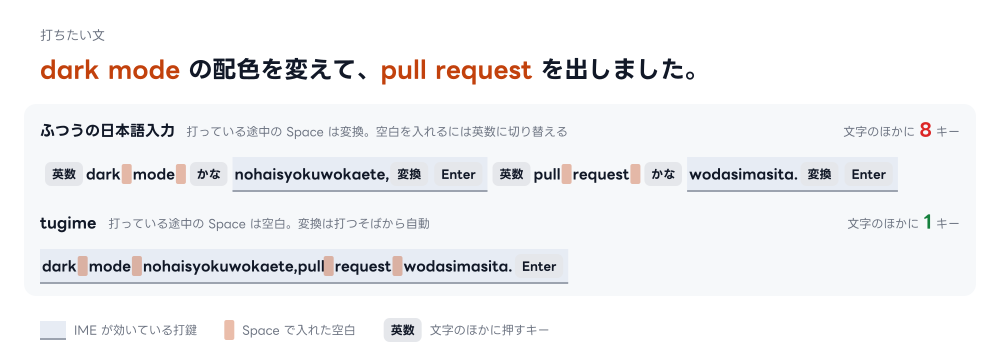
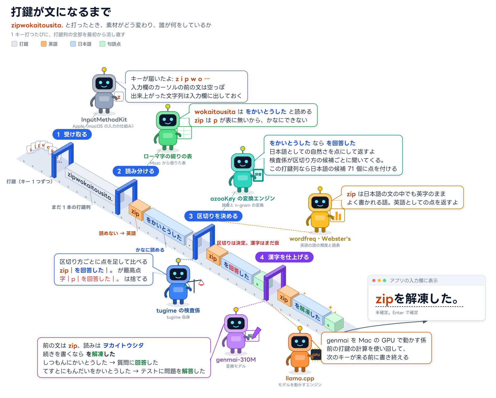

# tugime

英語まじりの日本語も、IME オンのまま切り替えずに打つだけ。macOS の日本語入力です。

/tsɯɡime/ 継ぎ目


英単語は英字のまま残り、日本語は文の流れに合った漢字になります。英語を打つたびに英数キーで英数モードに切り替えたり、変換し直したりしなくて大丈夫です。

## 特徴

### 英語は英語のまま

日本語モードで `ok` と打って「おk」になったことはありませんか？ tugime では、英単語は打ったとおりの英字で残ります。

| 打鍵 | 日本語モードのライブ変換 | tugime |
|---|---|---|
| `ok` | おk | ok |
| `testgaotitanode` | てstが落ちたので | testが落ちたので |

`api` や `hide` のようにローマ字としても読める語も、前後の文から英語か日本語かを決めます（[誤ることもあります](docs/limitations.md)）。

### 文の流れに合った漢字

tugime は、打った読みをまとめて読む変換モデルで漢字を選びます。後ろに続く語まで見て決めるので、「どうきがおそい」は「同期が遅い」に、「ずっとひいている」は「弾いている」になります。

| 打鍵 | 英語を見分けて辞書と統計で変換 | tugime |
|---|---|---|
| `Dropboxnodoukigaosoi.` | Dropboxの動機が遅い。 | Dropboxの同期が遅い。 |
| `CPUnohukagatakai.` | CPUの不可が高い。 | CPUの負荷が高い。 |
| `APInosiyouwosiraberu.` | APIの使用を調べる。 | APIの仕様を調べる。 |
| `pianowo,kodomonokorokarazuttohiiteiru.` | ピアノを、子供の頃からずっと引いている。 | ピアノを、子どもの頃からずっと弾いている。 |

### Space で区切って英文のように打てる

ふつうの日本語入力では、Space は変換のキーです。tugime は打つそばから変換するので、Space はそのまま空白になります。`coming soon` や `pull request` も、日本語モードのまま英文と同じように打てます。変換の候補を選びたいときは Shift+Space です。

| 打鍵 | tugime |
|---|---|
| `sonokinouhacoming soondesu.` | その機能はcoming soonです。 |



## 変換の仕組み



tugime は 1 キー打つたびに、打鍵列の全部をこの 4 つの工程に流し直します。ほかの日本語入力で崩れるのは、この工程の一部が無いためです。

- **日本語モードのライブ変換** には、工程 2 で読めない打鍵を英語にする分かれ道と、工程 3 で日本語と英語の区切り方を比べる処理がありません。日本語だけの文なら文脈に合った漢字を選べますが、英字もすべてローマ字として読むので、英単語が「おk」「てst」になります
- **英語を見分けて辞書と統計で変換する方式** は、工程 3 の仮の漢字で止まります。英単語は英字のまま残りますが、漢字は隣り合う語の組がどれだけよく使われるかで選ぶので、「zipを回答した」「動機が遅い」のような組になることがあります

上のデモと表の「日本語モードのライブ変換」は macOS 27 で実際に打った結果、「英語を見分けて辞書と統計で変換」は tugime の比較用の方式（`tugime-cli --method azookey`）の結果です。詳しい仕組みは [変換の仕組み](docs/how-it-works.md) にあります。

## 安全性

入力メソッドは、どのアプリで打った文字も受け取ります。tugime は、偽物を入れないためと、打った内容を外へ出さないために、次のことをしています。

- **導入**: 配布物が tugime のリポジトリで組み立てられたものかを確かめてから入れます。手順は「インストール」にあります
- **通信しない**: tugime は通信しません。さらに macOS の Sandbox で通信とファイルの読み書きを制限し、tugime に穴があって攻撃されたときの被害を減らします
- **記録しない**: 打ち方を学習せず、打った内容を保存しません
- **パスワード欄**: 安全入力が有効な間は、キーを変換せずにそのままアプリへ渡します

## 動作環境

Apple Silicon の macOS です。動作は macOS 27 でだけ確かめています。

## インストール

改竄されていない tugime を安全に入れるために、配布物が tugime の release workflow で組み立てられたものかを確かめてから入れる方法を案内します。tugime は Apple の有料の公証を受けていないので、代わりに GitHub 上での署名と[出自の証明](https://docs.github.com/en/actions/how-tos/secure-your-work/use-artifact-attestations/use-artifact-attestations)を使います。

入れ方は次の A〜C のどれか 1 つを選んでください。どれで入れても、初めて入れたときだけ、最後に入力ソースを追加します。

### A. mise で入れる

[mise](https://mise.jdx.dev/) を使うと、mise が配布物を確かめてから入れます。tugime の release workflow が署名していない配布物や、署名のあとで書き換えられた配布物は、mise が入れずに止めます。確かめには [packslip](https://packslip.dev/) という仕組みを使います。更新は `mise up` だけです。

mise は 2026.10.5 以降を使ってください。それより前の版は、下のコマンドの `workflow` の指定に対応していません。

```bash
mise use -g 'packslip:github.com/miyaoka/tugime[workflow="release.yml@refs/heads/main",postinstall="\"$MISE_TOOL_INSTALL_PATH/install.sh\" \"$MISE_TOOL_INSTALL_PATH/tugime.app\""]'
```

### B. GitHub CLI で入れる

mise を使わないときは、[GitHub CLI](https://cli.github.com/) で同じく確かめてから入れます。次のコマンドは、一時ディレクトリに最新版を取得し、tugime の release workflow が組み立てたものかを確かめ、確かめられたときだけ展開して入れます。更新するときも同じコマンドです。

```bash
dir=$(mktemp -d) &&
gh release download --repo miyaoka/tugime --pattern tugime-macos-arm64.tar.gz --dir "$dir" &&
gh attestation verify "$dir/tugime-macos-arm64.tar.gz" --repo miyaoka/tugime --cert-identity https://github.com/miyaoka/tugime/.github/workflows/release.yml@refs/heads/main &&
tar -xzf "$dir/tugime-macos-arm64.tar.gz" -C "$dir" &&
bash "$dir/install.sh"
```

### C. ソースから組み立てて入れる

Xcode（Swift 6.2 以降）と、[mise](https://mise.jdx.dev/) で入れる bun が要ります。組み立てのときに genmai-310M の GGUF（約 340MB）を Hugging Face から `.zenz/` に取得します。自分で組み立てるので、出自の確かめは要りません。

```bash
mise install --locked                   # mise.toml の版の bun を入れる
mise exec -- bun scripts/build-app.ts   # dist/tugime Dev.app を組み立てて ad-hoc 署名する
./install.sh "dist/tugime Dev.app"      # 配置して登録する
```

組み立てたものは `tugime Dev` という別の入力ソースになり、配布版の tugime と並べて入れられます。

### 入力ソースを追加する

初めて入れたときだけ、一度ログアウトしてログインし直してください。システム設定は、ログインし直すまで新しい入力ソースを一覧に出しません。その後、システム設定 → キーボード → 入力ソース → 「+」→ 日本語 から、配布版なら `tugime (日本語)`、ソースから組み立てたものなら `tugime Dev (日本語)` を追加します。tugime は自分では入力ソースを有効にしません。

## 使い方

ふだんどおりローマ字で打つだけです。

| キー | 動き |
|---|---|
| 英字・記号 | 打つそばから変換して表示します |
| Space | 空白を入れます |
| Shift+Space | 文節を選びます。もう一度押すと変換の候補を出します |
| Enter | 表示しているとおりに確定します |
| 英数 / かな | 英数モード / 日本語モードに切り替えます |

英語だけの文は、英数モードで打ってください。英語のまま残したい語がかなになるときは、大文字で打つ（`API`）か、tugime の辞書に登録してください。すべてのキー操作と辞書の書き方は [使い方](docs/usage.md) にあります。

## ドキュメント

- [使い方](docs/usage.md): キー操作、句読点と記号、日本語と英語の見分け方、tugime の辞書
- [変換の仕組み](docs/how-it-works.md): 区切りの決め方と、漢字の選び方
- [現状の制限](docs/limitations.md): 誤った変換になる既知の例と対処
- [開発](docs/development.md): 変換の確かめ方、精度の測り方、図の作り直し

## 使っているもの

tugime の変換は、azooKey の変換エンジンと、それを元にしたモデルの上に作られています。

- [AzooKeyKanaKanjiConverter](https://github.com/azooKey/AzooKeyKanaKanjiConverter)（MIT）と既定の辞書
- [genmai-310M](https://huggingface.co/subdiox/genmai-310M)（CC BY-SA 4.0。[zenz-v2.5-medium](https://huggingface.co/Miwa-Keita/zenz-v2.5-medium) を元にしたモデル）と [llama.cpp](https://github.com/azooKey/llama.cpp)（MIT）
- 既定のローマ字の綴り: [Mozc](https://github.com/google/mozc) の `src/data/preedit/romanji-hiragana.tsv`（BSD 3 条項。ライセンスの全文は `Sources/TugimeCore/Resources/romaji.tsv` の先頭）
- 英語の語の頻度: [wordfreq](https://github.com/rspeer/wordfreq) の日本語データ（CC BY-SA 4.0）
- 英語の綴りらしさを数える語表: macOS 同梱の Webster's Second International（1934 年、著作権切れ）と固有名詞表
- README と docs の図の字形: [LINE Seed JP](https://github.com/line/seed)（SIL Open Font License 1.1）

## ライセンス

tugime は [MIT](LICENSE) です。ただし `Sources/TugimeCore/Resources/` のデータは出典の利用条件に従います。条件はファイルの先頭か `App/Notices/` にあります。
