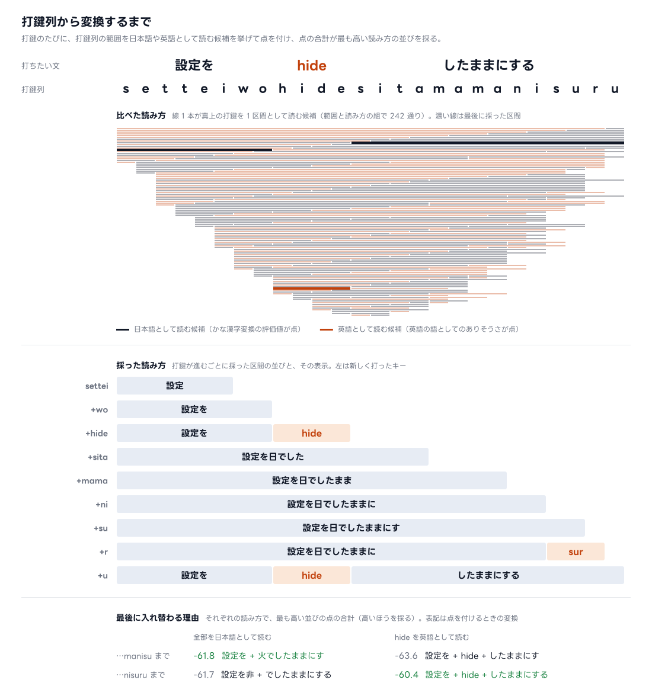

# 変換の仕組み

tugime は打鍵のたびに、未確定の打鍵列の全体を次の順に処理し直す。後ろで打った語が前の区切りや変換を決め直す。

1. 打鍵列を、日本語の区間と英語の区間の並びに分ける（区切りの採点。README の図の工程 2・3）
2. 日本語の区間を、区間の読みをまとめて読む変換モデルで漢字かな交じりにする（表示の変換。README の図の工程 4）

文節の選び直しと候補の窓は [使い方](usage.md) にある。

## 前の部分の確定

未確定の打鍵列が長くなり、表示の前の部分が打ち進めても変わらなくなると、その部分を確定する。確定した部分は変換し直さず、後ろの打鍵は確定した文字列に続けて区切りと変換をする。打っている語の途中では確定しない。

句読点の無い長い文でも、1 打鍵の処理が未確定の打鍵列の長さで重くなり続けないようにするため。

## 区切りの採点

打鍵列の範囲ごとに「日本語として読む」「英語として読む」の候補を挙げて点を付け、点の合計で区切りの候補を作る。英語にも日本語にも読める語（`note` `mode` `make`）があるときは、その語を英語にするか日本語にするかの組み合わせごとに区切りの候補を作る。区切りの候補は表示の変換で文にし、変換モデルが文として最も自然と見たものを採る。辞書では「野手を開く」と「noteを開く」はどちらも文法として成り立つので、文として比べて決める。

- 語は、利用者が前から打つのと同じ順に決めていく。新しく打った語の英語か日本語かを比べ、前の語の決め方は確からしいものを 2 つまで残す
- 句読点より前の区切りは、句読点を打った時点で決まり、後ろを打っても決め直さない

- 綴りの表で読めない並びを含む範囲は、日本語の候補にならない。そこは必ず英語になる
- 日本語の候補の点は、[Mozc](https://github.com/google/mozc) の OSS 辞書の語と品詞の連接でかな漢字変換したときの評価値。文頭の日本語は文の始まりとして、英語の区間の後の日本語は前の語に続く形として採点する（英語が名詞として働く「make を」の「を」）。数字の後は助数詞として採点する
- 英語の候補の点は、日本語の文の中に英字のまま書かれる語の頻度と、英語の綴りらしさを合わせたもの
- 1 つのかなになる綴り（`ga` `no`）と、読める 2 文字以下の綴りと、読めて英単語でない綴りは、日本語として採れるなら英語にしない
- tugime の辞書に登録した打鍵は、上の規則より優先する。`en` で登録した打鍵は読める綴りでも英語に、`ja` で登録した読めない打鍵（`cafe`）は日本語の語になる（[使い方](usage.md)）

採点では区間の候補の数だけ変換を呼ぶので、軽い変換（辞書の語と品詞の連接）を使う。採点する日本語の 1 区間の長さには上限があり、長い日本語は短い区間をつないだものとして採点する。

## 表示の変換

区切りの候補の日本語の区間を、変換モデル [genmai-310M](https://huggingface.co/subdiox/genmai-310M) で変換する。採点のように区間の候補ごとには呼ばず、区切りの候補ごとに呼ぶ。区切りの候補どうしの変換は同時に計算する。

- モデルは区間の読みをまとめて読むので、区間の中の後ろの語も漢字を選ぶ手がかりになる。「ずっとひいている」は「弾いている」、「どうきがおそい」は「同期が遅い」になる
- 区間の読みに加えて、入力欄のカーソルより前の文字列（上限がある）と、同じ入力の中でその区間より前の表示を、左の文脈として渡す。英語の区間もこの文脈に入る
- 区間は前から順に変換し、各区間は左の文脈しか見ない。英語の区間より後ろの日本語の区間は、それより前の区間の変換の手がかりにならない
- 打鍵ごとの表示を次の打鍵より前に返すため、前の打鍵の計算を使い回す
- 文節の境目と候補の窓は、採点の変換から取る。利用者の辞書の語は採点の変換が使うので、モデルの出力がその語を含まない文節だけ、採点の変換の表記にする
- モデルは辞書の語を並べるのではなく、読みを手がかりに文を書く。書けるのは辞書の語と、読みに沿った並びに限られないので、文として自然なら打った読みと違う語も書き、tugime はそれをそのまま表示する。表示のかなが打った読みと合わないときは、そのことを知らせる（[現状の制限](limitations.md#表示が打った読みどおりにならない)）

## 他の入力方式との違い

日本語入力は、英字をどう扱うかと、漢字をどう選ぶかで結果が変わる。

| 方式 | 英字の扱い | 漢字の選び方 |
|---|---|---|
| 日本語モードのライブ変換 | すべてローマ字として読む（`ok` は「おk」） | 仕組みは公開されていない。日本語だけの文は文脈に合った漢字を選ぶ。打ち進めると前の部分から確定していく |
| 英語を見分けて辞書と統計で変換（tugime の `--method lattice`） | tugime と同じく英字のまま残す | 語の出やすさと、隣り合う品詞の組がどれだけ自然か |
| tugime | 入力全体の点の比較で英語の部分を決め、英字のまま残す | 区間の読みと左の文脈を読む変換モデル |

## Space

打っている途中の Space は空白を入れる。日本語入力では Space を変換に使うのがふつうだが、tugime は打つそばから変換して表示するので、変換の操作を Space から Shift+Space に移した。これで `coming soon` のような空白入りの英語を、日本語モードのまま英文と同じ打ち方で打てる。空白で確定しないので、空白の後ろで打った語も前の区切りと変換を決め直す手がかりになる。

## 学習

打ち方や選んだ候補を学習しない。同じ打鍵の並び（消した打鍵も含む）と同じ前の文からは、いつも同じ表示になる。
