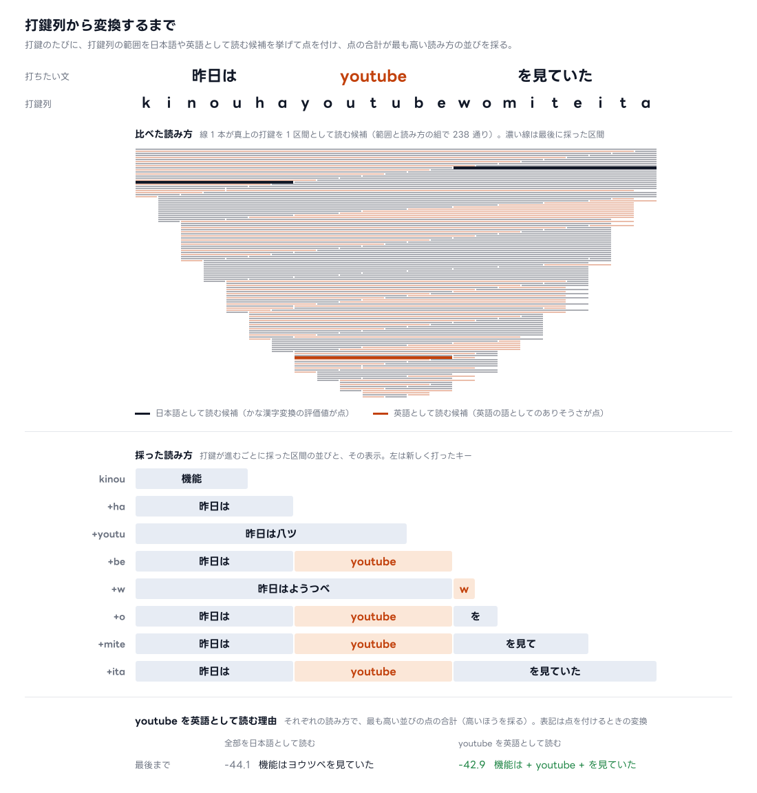

# 変換の仕組み

tugime の変換は、未確定の打鍵列の全体を次の順に処理し直す。Enter を押すまで前の部分を確定しないので、後ろで打った語が前の区切りや変換を決め直す。

1. 打鍵列を、日本語の区間と英語の区間の並びに分ける（区切りの採点。README の図の工程 2・3）
2. 日本語の区間を、区間の読みをまとめて読む変換モデルで漢字かな交じりにする（表示の変換。README の図の工程 4）

文節の選び直しと候補の窓は [使い方](usage.md) にある。

## 区切りの採点

打鍵列の範囲ごとに「日本語として読む」「英語として読む」の候補を挙げて点を付け、入力全体で点の合計が最も高い並びを採る。

- 綴りの表で読めない並びを含む範囲は、日本語の候補にならない。そこは必ず英語になる
- 日本語の候補の点は、[Mozc](https://github.com/google/mozc) の OSS 辞書の語と品詞の連接でかな漢字変換したときの評価値。文頭の日本語は文の始まりとして、英語の区間の後の日本語は前の語に続く形として採点する（英語が名詞として働く「make を」の「を」）。数字の後は助数詞として採点する
- 数字は日本語の候補の読みに入り、Mozc と同じく「数」の品詞の語として採点する（`3kamo4kamoyasumu` は 1 つの日本語の候補「3かも4かもやすむ」）
- 英語の候補の点は、日本語の文の中に英字のまま書かれる語の頻度と、英語の綴りらしさを合わせたもの。英字の部分の点は綴りだけで決まり、前後の語によらない。英語の候補の中の数字は、英語の綴りらしさではなく、日本語の候補と同じく数の語として採点する
- 1 つのかなになる綴り（`ga` `no`）と、読める 2 文字以下の綴りと、読めて英単語でない綴りと、数字だけの綴りは、日本語として採れるなら英語にしない。数字と英字が混ざる綴りは点で比べる（`3i` は 3位、`3a` は 3a）
- tugime の辞書に登録した打鍵は、かな漢字変換に入れた利用者の語 1 つと同じ強さで点の比べ合いに加わる。登録した打鍵がそのまま 1 つの区間になれば、`en` で登録した打鍵は読める綴りでも英語に、`ja` で登録した読めない打鍵（`cafe`）は日本語の語になる。より長い日本語の読みが登録した打鍵をまたぐ区切りが勝てば、ふだんの変換になる（[使い方](usage.md#tugime-の辞書)）

採点では区間の候補の数だけ変換を呼ぶので、軽い変換（辞書の語と品詞の連接）を使う。

日本語にも英語にも読める綴りは、点の比べ合いで決まる。綴りだけでは決まらないので（`commitsuru` は commit＋する とも com＋みつる とも読める）、どの点の付け方でも誤る入力が残る。よく使う英単語でも、日本語として読む並びの点の合計が上回れば日本語になる（`makewojikkousuru` は 負けを実行する、`namewohenkousuru` は 舐めを変更する）。英語の語をスペースで区切って打つと、英語に読まれやすくなる（`make wojikkousuru` は make を実行する。[使い方](usage.md#日本語と英語の見分け方)）。

## 表示の変換

区切りが決まった日本語の区間だけを、変換モデル [genmai-310M](https://huggingface.co/subdiox/genmai-310M) で変換して表示する。採点のように区間の候補ごとには呼ばないので、重く質の高い変換を使える。モデルに渡るのは日本語の区間の読みと左の文脈だけなので、区切りの誤り（英語の語の後半が日本語の区間に入ったもの）は、モデルでは直らない。

- モデルは区間の読みをまとめて読むので、区間の中の後ろの語も漢字を選ぶ手がかりになる。「ずっとひいている」は「弾いている」、「どうきがおそい」は「同期が遅い」になる
- 区間の読みに加えて、入力欄のカーソルより前の文字列（上限がある）と、同じ入力の中でその区間より前の表示を、左の文脈として渡す。英語の区間もこの文脈に入る
- 区間は前から順に変換し、各区間は左の文脈しか見ない。英語の区間より後ろの日本語の区間は、それより前の区間の変換の手がかりにならない
- 打った文字は変換を待たずに表示する。まだ変換が終わっていない打鍵は、それより前の変換の表示の後ろに、かな（読めない打鍵は打ったまま）でつなぎ、変換が終わったら差し替える。打鍵が変換より速く続くあいだは、途中の打鍵列は変換せず、最新の打鍵列を変換する
- 打っている途中の Backspace は、表示の最後の 1 文字をその下の打鍵ごと消し、残りの表示は変換し直さない。残した表示は、文節に区切ったときの表記にもそのまま使う。残した日本語の区間に読みを打ち足すと、その区間を変換し直す。句読点や記号、空白で区切った英語を続けたときは、前の区間は残した表記のまま
- 確定するとき（Enter、入力欄の外への移動、英数への切り替えなど）は、そのとき表示している文字列を確定する。変換が終わっていない部分はかなのまま確定する
- 文節の境目と候補の窓は、採点の変換から取る。候補の窓には、文節の読みか記号を読みとする記号（Mozc の記号辞書）も足す。記号は候補の窓にだけ足し、区切りの採点と表示には使わない。利用者の辞書の語は採点の変換が使うので、モデルの出力がその語を含まない文節だけ、採点の変換の表記にする
- モデルは辞書の語を並べるのではなく、読みを手がかりに文を書く。書けるのは辞書の語と、読みに沿った並びに限られないので、文として自然なら打った読みと違う語も書き、tugime はそれをそのまま表示する。表示のかなが打った読みと合わないときは、そのことを知らせる（[現状の制限](limitations.md#表示が打った読みどおりにならない)）

## 他の入力方式との違い

日本語入力は、英字をどう扱うかと、漢字をどう選ぶかで結果が変わる。

| 方式 | 英字の扱い | 漢字の選び方 |
|---|---|---|
| 日本語モードのライブ変換 | すべてローマ字として読む（`ok` は「おk」） | 仕組みは公開されていない。日本語だけの文は文脈に合った漢字を選ぶ。打ち進めると前の部分から確定していく |
| 英語を見分けて辞書と統計で変換（tugime の `--method lattice`） | tugime と同じく英字のまま残す | 語の出やすさと、隣り合う品詞の組がどれだけ自然か |
| tugime | 入力全体の点の比較で英語の部分を決め、英字のまま残す | 区間の読みと左の文脈を読む変換モデル |

## Space

打っている途中の Space は空白を入れる。日本語入力では Space を変換に使うのがふつうだが、tugime は打つそばから変換して表示するので、変換の操作を Space から Shift+Space に移した。これで `coming soon` のような空白入りの英語を、日本語モードのまま英文と同じ打ち方で打てる。空白で確定しないので、空白の後ろで打った語も前の区切りと変換を決め直す手がかりになる。

## 学習

打ち方や選んだ候補を学習しない。同じ打鍵列と同じ前の文からは、いつも同じ表示になる。
